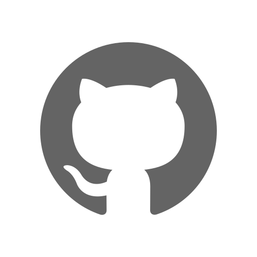

<div align="center">
  <p></p>
  <h1><code>SANITYME</code></h1>
</div>

<table>
  <tbody><tr><td align="center" width="99999"><div>
    <a href="https://olankens.com">WEBSITE</a> ·
    <a href="https://ko-fi.com/olankens">FUNDING</a>
  </div></td></tr></tbody>
  <tbody><tr><td align="center" width="99999">&nbsp;<div>
    Bash script for GitHub repo setup with simple commits, AGENTS.md, Renovate, MIT License, README file, and repo security for small code base since the first commit was set on day one, designed to scale.
  </div>&nbsp;</td></tr></tbody>
  <tbody><tr><td align="center" width="99999">
    <a href="https://github.com"></a>
    <picture></picture>
    <a href="https://github.com/renovatebot/renovate"></a>
    <picture></picture>
    <a href="https://wikipedia.org/wiki/Bash_(Unix_shell)"></a>
  </td></tr></tbody>
</table>

## PREVIEWS

<table><tbody><tr><td width="99999">
  <picture></picture>
</td></tr></tbody></table>

## MATRICES

<table>
  <tbody><tr align="center">
    <th><samp>AND</samp></th>
    <th><samp>IOS</samp></th>
    <th><samp>LIN</samp></th>
    <th><samp>MAC</samp></th>
    <th><samp>WIN</samp></th>
    <th><samp>WEB</samp></th>
  </tr></tbody>
  <tbody><tr align="center" height="50">
    <td width="9999">❌</td>
    <td width="9999">❌</td>
    <td width="9999">✅</td>
    <td width="9999">✅</td>
    <td width="9999">❌</td>
    <td width="9999">❌</td>
  </tr></tbody>
</table>

## FEATURES

<table>
  <tbody><tr><td width="99999">Generate AGENTS configuration files to establish coding standards and commit message rules across developer workflows inside repository structure while maintaining quality throughout lifecycles.</td><td>✅</td></tr></tbody>
  <tbody><tr><td>Install conventional commit hooks through Subduing integration that validates message formats before allowing remote pushes and branch pull requests to proceed while keeping contributions formatted.</td><td>✅</td></tr></tbody>
  <tbody><tr><td>Harden GitHub repository settings by disabling discussions, issues, projects, and wiki pages while enforcing clean rebase merge strategies that protect code integrity across development work.</td><td>✅</td></tr></tbody>
  <tbody><tr><td>Create MIT license documentation with automatic copyright year updates triggered annually through scheduled GitHub Actions workflows that keep legal notices current and ensure compliance over time.</td><td>✅</td></tr></tbody>
  <tbody><tr><td>Build README templates containing preview images, feature tables, platform compatibility matrices, and installation instructions for projects needing professional documentation ready to share.</td><td>✅</td></tr></tbody>
  <tbody><tr><td>Configure Renovate dependency management with recommended settings that automerge minor plus patch updates while keeping software dependencies fresh and secure against known external vulnerabilities.</td><td>✅</td></tr></tbody>
  <tbody><tr><td>Clean legacy configuration artifacts including outdated workflow files, package manager remnants, and deprecated agent documentation from repositories so teams start fresh by avoiding technical debt.</td><td>✅</td></tr></tbody>
  <tbody><tr><td>Provide flexible command line flags enabling selective activation of individual setup modules so teams customize which automation features apply and skip unnecessary configuration during onboarding.</td><td>✅</td></tr></tbody>
</table>

## LEARNING

### WITH DEFAULT FLAGS

```shell
curl -fsSL https://github.com/olankens/sanityme/releases/latest/download/sanityme.sh | bash
```

### WITH CUSTOM FLAGS

```shell
curl -fsSL https://github.com/olankens/sanityme/releases/latest/download/sanityme.sh | bash -s -- \
  --agents=true \
  --conventional=true \
  --hardening=true \
  --license=true \
  --readme=true \
  --renovate=true
```

### SETUP COMMIT HOOK

```shell
mkdir -p "$(git rev-parse --git-path hooks)"
curl -fsSL --retry 3 'https://raw.githubusercontent.com/olankens/subduing/HEAD/source/subduing.sh' -o "$(git rev-parse --git-path hooks)/commit-msg"
chmod +x "$(git rev-parse --git-path hooks)/commit-msg"
```

### DITCH COMMIT HOOK

```shell
rm -f "$(git rev-parse --git-path hooks)/commit-msg"
```
